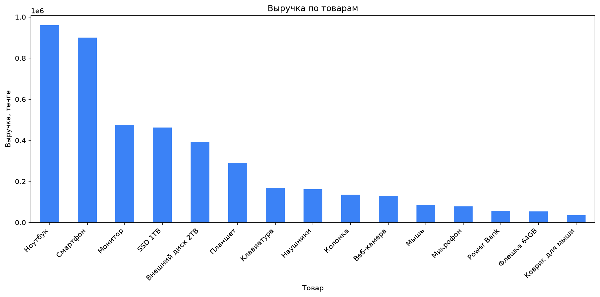
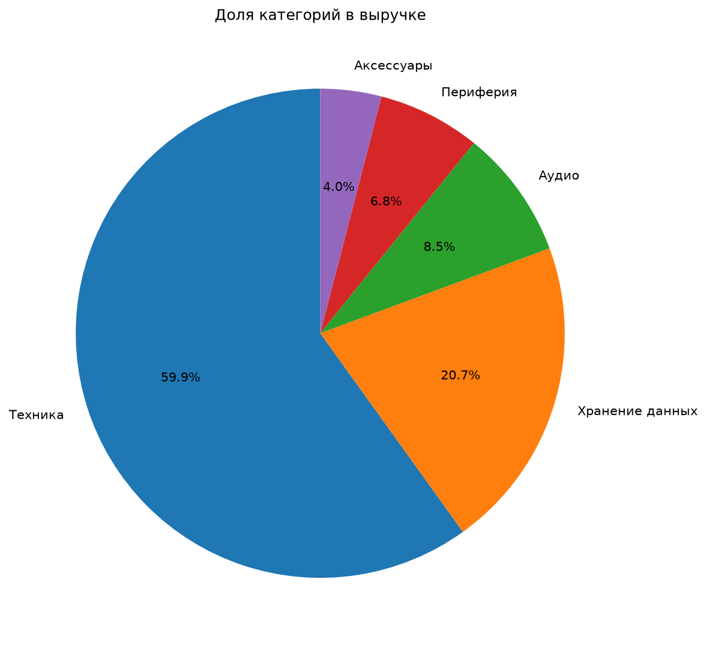
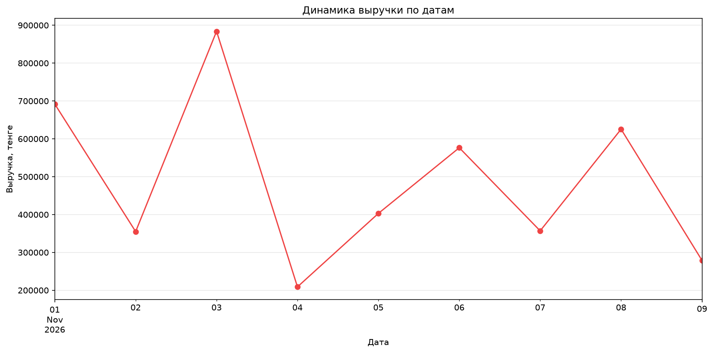
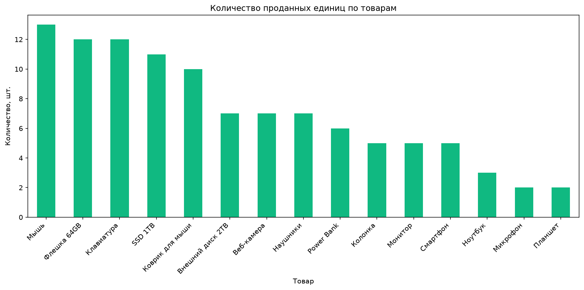
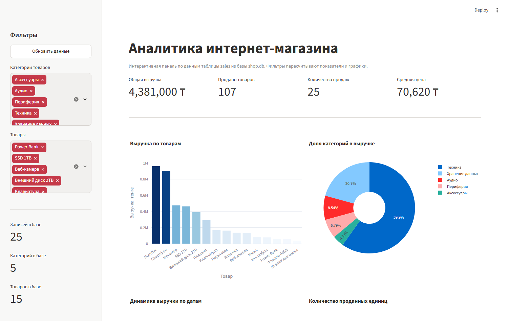

# Аналитика интернет-магазина

Учебный проект по практике: аналитическая система на Python, которая хранит данные о продажах в SQLite, выполняет анализ с помощью Pandas, строит графики в Matplotlib и предоставляет интерактивный дашборд на Streamlit.

## Описание

Проект разработан в рамках пятидневной практики «Создание базы данных и работа с SQL» и охватывает полный цикл работы с данными:

- создание базы данных SQLite и наполнение её данными;
- SQL-запросы на выборку, фильтрацию, сортировку и подсчёт;
- расчёт выручки и других показателей средствами Pandas;
- визуализация данных в Matplotlib (сохранение графиков в PNG);
- проверка качества данных, поиск пропусков, дубликатов и выбросов;
- интерактивный дашборд на Streamlit с фильтрами, диаграммами и экспортом CSV.

## Использованные технологии

- Python 3.12
- SQLite (`sqlite3`)
- Pandas
- Matplotlib
- Plotly
- Streamlit
- python-docx (для итогового отчёта)

## Структура проекта

```
data-analytics-practice/
├── setup_db.py          # создание БД и добавление записей
├── check_db.py          # проверка данных и SQL-запросы
├── analysis.py          # анализ данных, графики, качество данных
├── dashboard.py         # интерактивное приложение Streamlit
├── shop.db              # база данных SQLite (25 записей)
├── requirements.txt     # зависимости проекта
├── README.md            # описание проекта
├── day3_report.md       # отчёт по качеству данных (день 3)
├── charts/
│   ├── products.png
│   ├── categories.png
│   ├── quantity.png
│   ├── daily.png
│   └── daily_quantity.png
├── screenshots/
│   ├── dashboard.png
│   └── dashboard_full.png
└── report/
    └── practice_report.docx
```

## Установка

Рекомендуется использовать виртуальное окружение.

```bash
python -m venv .venv
```

Windows (PowerShell):

```powershell
.\.venv\Scripts\Activate.ps1
```

Linux / macOS:

```bash
source .venv/bin/activate
```

Установка зависимостей:

```bash
python -m pip install -r requirements.txt
```

## Запуск

1. Создание базы данных и заполнение её записями:

```bash
python setup_db.py
```

Скрипт можно запускать повторно — дубликаты не добавляются.

2. Проверка данных и выполнение SQL-запросов:

```bash
python check_db.py
```

3. Анализ данных и построение графиков:

```bash
python analysis.py
```

Все графики сохраняются в папку `charts/`.

4. Запуск интерактивного дашборда:

```bash
streamlit run dashboard.py
```

Если команда `streamlit` недоступна:

```bash
python -m streamlit run dashboard.py
```

## Возможности приложения

### База данных

- Таблица `sales` с полями: `id`, `product`, `category`, `price`, `quantity`, `sale_date`.
- 25 записей о продажах.
- 5 категорий: Техника, Аксессуары, Периферия, Аудио, Хранение данных.
- Защита от дубликатов при повторном запуске `setup_db.py`.

### SQL-запросы (`check_db.py`)

- вывод всех записей;
- товары дороже 20 000 тенге;
- товары выбранной категории;
- сортировка по цене от дорогой к дешёвой;
- подсчёт количества записей;
- количество записей и проданных единиц по категориям.

### Анализ данных (`analysis.py`)

- расчёт выручки (цена × количество);
- общая выручка магазина;
- общее количество проданных единиц;
- топ-3 товара по выручке;
- выручка по товарам и категориям;
- анализ по датам, дни с максимальной и минимальной выручкой;
- проверка пропусков и дубликатов;
- расчёт средней и медианной цены;
- исследование влияния выброса на среднее значение;
- сохранение пяти графиков в PNG;
- аналитические выводы.

### Дашборд (`dashboard.py`)

- четыре аналитических показателя: общая выручка, продано товаров, количество продаж, средняя цена;
- четыре интерактивных графика Plotly;
- фильтры по категориям и товарам;
- таблица продаж;
- экспорт отфильтрованных данных в CSV;
- корректная обработка пустого результата фильтрации;
- кнопка обновления данных из базы.

## Результаты анализа

- Общая выручка магазина: **4 381 000 ₸**.
- Продано единиц товара: **107**.
- Количество записей в базе: **25**.
- Самая выгодная категория — **Техника** (59,9 % выручки).
- Самый выгодный товар — **Ноутбук** (960 000 ₸).
- Максимальная дневная выручка приходится на **2026-11-03** (884 000 ₸).
- Минимальная дневная выручка приходится на **2026-11-04** (209 000 ₸).

> Точные значения пересчитываются при каждом запуске `analysis.py` и дашборда, поэтому после изменения базы данных показатели обновляются автоматически.

## Графики

| Выручка по товарам | Доля категорий |
| --- | --- |
|  |  |

| Динамика выручки | Количество проданных единиц |
| --- | --- |
|  |  |

## Скриншоты дашборда



Полная версия страницы со всеми графиками и таблицей: [screenshots/dashboard_full.png](screenshots/dashboard_full.png).

## Итоговый отчёт

Документ Word с описанием проекта, технологий, базы данных, графиков и выводов находится в файле `report/practice_report.docx`.

## Автор

ФИО: Фролов Степан 4-25п
